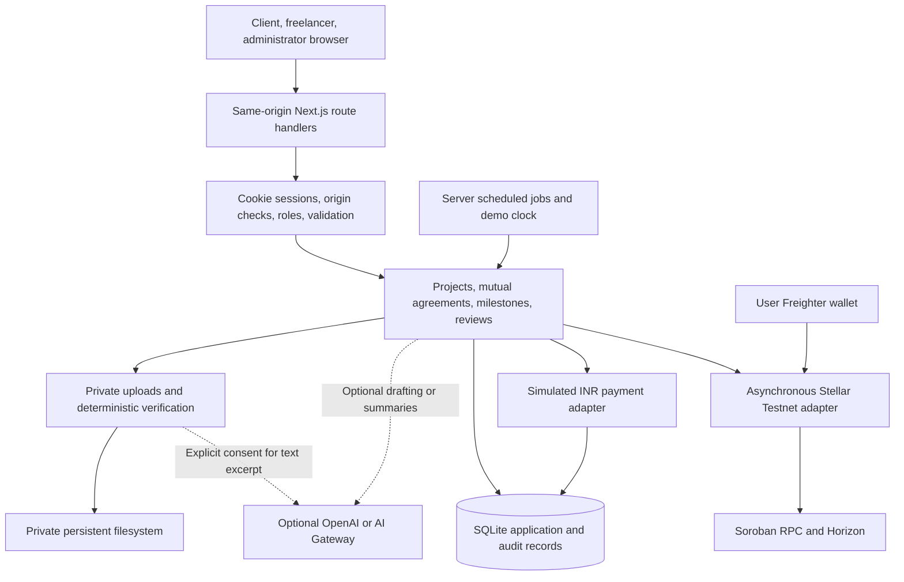

# MilestoneGuard architecture

Current implementation: one Next.js 16 / React 19 / TypeScript application on Node 24.8+, SQLite via `node:sqlite`, private local files, custom CSS and Lucide icons. Tailwind, shadcn, Supabase Auth/PostgreSQL/Storage and cloud object storage are **not installed application adapters**. SQLite is the deliberate working demo database, not a silent production fallback.

## Request and data flow

The browser requests an operation; route guards authenticate a session, enforce origin and request limits, and call domain services. Services validate role, project membership, current assignment, immutable agreement version and permitted state. SQLite transactions/savepoints serialize writes. Reads and authorized file downloads apply server-side visibility rules. Public registration can create only client/freelancer roles; seed administration is a fictional local setup.

| Module                  | Actual implementation                                                                                                                                         |
| ----------------------- | ------------------------------------------------------------------------------------------------------------------------------------------------------------- |
| Identity                | `src/lib/auth.ts`: salted scrypt password hashes, hashed opaque sessions, expiry, persistent rate limits                                                      |
| Projects and agreements | `service.ts`: invitation, budget/deadline validation, snapshots/hashes, two acknowledgements, versioned amendments                                            |
| Evidence                | `uploads.ts`, `verification.ts`, `scripts/verify-pdf.cjs`: authorized private files, immutable versions, hashes, type/size checks, bounded image/PDF decoding |
| AI                      | `ai.ts`: schema-validated optional advisory calls, timeout/fallback, no financial tools                                                                       |
| Local payment           | `payments.ts`: atomic simulated request/confirmation, unique intents/ledger references, integer paise                                                         |
| Receipts                | `payment-history.ts`: actual request/confirmation events plus separate recipient acknowledgement; no additional transfer                                      |
| Blockchain              | `src/lib/stellar/`: wallet proofs, canonical commitments, exact stroop strings, transaction preparation and confirmed reconciliation                          |
| Monitoring              | `risk.ts`, service jobs: stored policy, meaningful activity and acknowledged deadlines, deterministic demo clock                                              |
| Disputes                | service actions and `dispute-review.ts`: claims, versions, reviewer, references, reasoned human outcomes                                                      |
| Recovery                | service actions: accepted-only handover, archived original obligations, fresh replacement milestone IDs/agreement                                             |
| Completion              | `completion.ts`: current work terminal, original/current balances conserved, no open disputes/pending agreements or payments                                  |
| Legal records           | `legal-orders.ts`: admin metadata, external findings and links to already confirmed transactions; no payment execution import                                 |
| History                 | `/api/history`: scoped cursor pagination (1–100/page), stable date/ID ordering                                                                                |

## Payment flow and authority

`LOCAL_DEMO`: mutual agreement → funding intent/request event → simulated confirmation/ledger → submission → human acceptance → separate payout request → confirmation/ledger. Authorized disputes permit bounded releases/refunds. Payment confirmation and user receipt acknowledgement are separate facts. Repeating an acknowledgement never transfers funds. The demo has no provider webhooks: the adapter rejects unsupported webhook processing rather than pretending to validate signatures.

`STELLAR_TESTNET`: immutable XLM project mode → session/origin-bound wallet ownership proof → fixed client/freelancer/resolver escrow → wallet-signed transaction → network success and expected event/state validation → atomic read-model reconciliation. Unknown outcomes remain pending/blocked; a local timeout is not network failure. No private user key is held by the server. Full release/refund is supported; on-chain split settlement is future scope. See [blockchain details](docs/BLOCKCHAIN.md).

INR paise and XLM stroops are distinct; Testnet project legacy numeric budgets are tracking weights, never INR assets. Recovery does not move old escrow to the replacement. Completion checks both engagements.

## Verification and AI boundaries

UTF-8 text up to 256 KiB supports agreed literal phrases; PNG/JPEG are fully decoded within 25 million pixels; PDF parsing uses an isolated 96 MiB worker, three-second timeout, maximum 5 MiB/500 pages. Optional agreed filename/dimensions/text rules are snapshotted in the agreement. An objective failure blocks ordinary acceptance. Unsupported semantic checks remain `NEEDS_REVIEW`; an authorized dispute process can separately determine an outcome. ZIP/PPTX/MP4 currently receive signature/size checks, not full archive/video analysis or malware certification.

Scope Doctor produces editable proposals. Deliverable AI sees metadata by default; text excerpts require server enablement, explicit uploader consent and configured credentials. Advisory evidence claims must quote an actual supplied substring. Dispute summaries require known record references. These checks reduce unsupported claims; they do not prove model reasoning or quality. No model controls acceptance, liability or money.

## Persistence, deployment and scale

Migrations `001`–`003` retain foreign keys and database constraints; `003` adds payment events/acknowledgements, legal records and history/domain indexes. Current `.env.local` uses **`data/blockchain-dev.sqlite` / `data/blockchain-uploads`**; fresh setup defaults to `data/milestoneguard.sqlite` / `data/uploads`. Original data was preserved before this pass. Test DBs are isolated and explicitly configured.

Use one Node host with retained writable disk and a scheduler (`npm run jobs:watch` locally; supervised scheduler in a pilot). Synchronous SQLite serializes writes; several bootstrap/domain reads still load collections and are not large-scale queries. Audit pagination and added indexes improve bounded history access, not all-product scalability. Notifications remain in-app, not email/SMS. Audit immutability is application/constraint level, not protection from a privileged DBA.

Before a controlled pilot: HTTPS, restore-tested backups, monitored jobs, verified identity/recovery, shared abuse limits, scanning, approved contracts/payment provider and operational review. Then migrate through an explicit tested PostgreSQL repository adapter and private object storage; preserve money units, foreign keys, access checks, idempotency and settlement invariants. Do not assume SQLite transactions, JSON indexes, locking or authorization translate automatically to Supabase/RLS. Introduce durable queues/workers and an outbox for external payments when required; separate services only after measured load justifies it. Stateless multi-instance serverless hosting is not supported by the current storage adapter.
